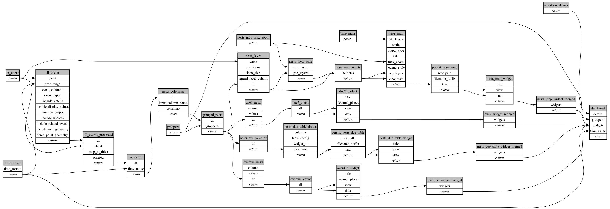

```
# AUTOGENERATED BY ECOSCOPE-WORKFLOWS; see fingerprint in README.md for details

```

```yaml
# fingerprint:
artifacts_sha256_basic: d343d52257afd7be3a2155c4b4c02219f79f05fd5978d067ad87fb624fb884f4
artifacts_sha256_strict: 29e4fe13f29599b3cdf8fc491708e56096565ccb4dd11d7a72a75de1e2a88a9a
installed_requirements:
- channel: https://repo.prefix.dev/ecoscope-workflows/
  name: ecoscope-platform
  version: {version: ==2.18.0}
- channel: https://repo.prefix.dev/ecoscope-workflows-custom/
  name: ecoscope-workflows-ext-custom
  version: {version: ==0.1.0rc24}
- channel: conda-forge
  name: pydeck
  version: {version: ==0.9.2}
- channel: https://repo.prefix.dev/ecoscope-workflows-custom/
  name: ecoscope-workflows-ext-curacao
  version: {version: ==0.0.4}
params_sha256: 4c936a6525c595a59a0412ce10c6663ff2f68650723fab9cd518f89af2989c69
spec_sha256: 9a5b7a99df23c2286bd3a1aca17735764d26e34aea509177681281d653191bfd

```

# ecoscope-workflows-nests-due-hatching-workflow


